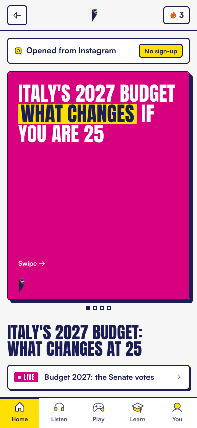
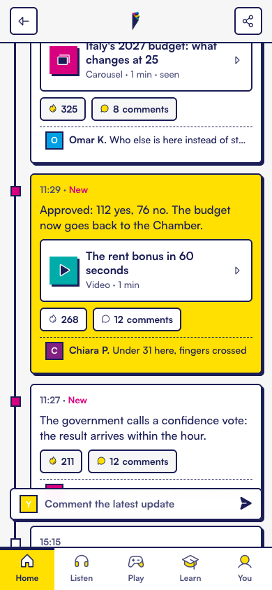
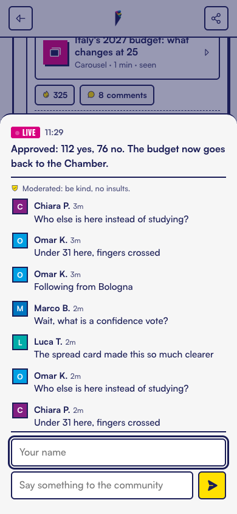
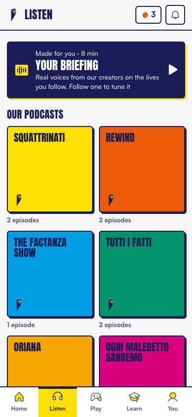

# One story leads to another

**A community app for [Factanza](https://www.factanza.com), the Italian Gen Z news brand: built in a weekend for the Factanza Hackathon (Challenge 2, platform and community).**

[**Try the app**](https://factanza-demo.vercel.app/demo/) · [**Pitch site**](https://factanza-demo.vercel.app) · [**Design system**](https://factanza-demo.vercel.app/design-system.html)

<p align="center">
  
  
  
  
</p>

The app is a phone-sized web app: open it on a phone, or on desktop where it shows as a phone column.

## The problem

Factanza reaches about 2 million people a month on Instagram and TikTok, but that audience lives on other platforms.
The brief: turn that reach into a community that comes back to Factanza itself, and moves closer to its paid services
(Academy courses, subscription, books, the board game).

## The idea

Not another news aggregator with AI recommendations. The app is built around **following a story together**:

1. You land from an Instagram post: no sign-up, the story opens straight away.
2. You **follow a live event**: a budget vote in the Senate, or a reality show final. Updates arrive in real time, and
   people react and comment on each update.
3. A followed event **stays pinned in Home**, next to the weekly quiz and its streak. Notifications bring you back when
   something happens.
4. Factanza's services live **inside** the app rather than as outside links: podcasts with a persistent player, the
   board game, Academy lessons, books and newsletters.

The ideas and product decisions came from the team. Contents, numbers and the Zanichelli partnership in the demo are
examples.

## What I built

| | |
|---|---|
| **App demo** (`demo/`) | Single-page app in plain JavaScript (about 640 lines, no framework): its own router, a state saved on the phone, bottom sheets, a persistent audio player, a quiz with a streak, notifications, a share flow. |
| **Live server** (`server/`) | A Node server with **zero dependencies**. It runs an 8-minute live cycle that is the same for everyone and adds simulated community activity while people watch. It stores real comments, reactions and follows. |
| **Database** | Supabase (Postgres). The tables are closed to the public: everything goes through database functions that check their inputs, and every write needs the server key. |
| **Pitch site** (`index.html`) | A landing page with a 3D version of Factanza's logo in three.js, plus slides and a QR code to the demo. It also exports to a single HTML file that works offline (`npm run export`). |
| **Design system "Tessera"** | `DESIGN.md`, `tokens.css`, `design-system.html`. Every element is a tile with depth that "lifts" from flat to 3D, in Factanza's colours and typography. |
| **Team voting tool** (`voti/`) | The small live app the team used to pick ideas from our phones. |

### Engineering details

- **Real time through anything.** The app first tries a Server-Sent Events stream. If nothing arrives within 5 seconds,
  because some tunnels hold the stream back, it switches to asking the server every 2 seconds, and every 15 seconds when
  the tab is hidden. When the server comes back or restarts, the app reloads the state instead of showing stale data.
- **A free public link with a stable address.** The pages are hosted on Vercel, which forwards `/api` to a Cloudflare
  tunnel running on my Mac. `npm run share` opens the tunnel and redeploys the pages with the tunnel's new address.
  Behind both proxies the server reads the real visitor IP from Vercel's own header, and ignores headers the client
  could fake.
- **Works with the server off.** `tools/record-live.mjs` records a full live cycle into `demo/recorded.json`, keeping
  only the simulated comments. When the server is unreachable, the app plays that recording, so the link above always
  shows a full live event.
- **Moderation.** A filter for Italian and English insults that also catches:
  - letters swapped for numbers (`c4zz0`);
  - repeated letters, accents, and invisible or direction-changing characters.

  It also limits each person to one comment every 3 seconds, with a global cap per minute on top.
- **Break test.** Before the pitch, 4 AI agents tried to break the app: hostile routes such as `#/c/constructor`,
  corrupted saved state, bad URLs, a missing content type on posts, two open tabs, interrupted connections. The fixes are
  in commit `999c4d4`. They include a crash from a malformed URL and fake IDs that reached the database; both are now
  rejected.
- **Small on purpose.** No build step and no framework; fonts and icons (Phosphor duotone) come from public CDNs and the
  server needs only Node 22.

## Run it locally

```bash
npm install
npm start            # http://127.0.0.1:8790 (site) and /demo/ (app)
```

Without a Supabase key (`server/data/supabase.json`, which is not in the repo), you can still open the pages with any
static server. The app then plays the recorded live event:

```bash
npx serve .          # then open /demo/?reset=1
```

How the server works and how to move it to another computer: [`server/README.md`](server/README.md).

## Repository map

```
demo/          the app: index.html, demo.js, demo.css, data.js (content), recorded.json (recorded live)
server/        live server, events and timing (events.mjs), public link (share.sh, vercel.sh)
index.html     pitch site: site.js, site.css, i18n.js (Italian), logo3d.js (3D logo)
DESIGN.md      design system, with tokens.css and design-system.html
PRODUCT.md     product brief: users, positioning, constraints
docs/          plan of the live demo, screenshots
tools/         export.py (single-file site), record-live.mjs
voti/          team idea voting tool
```

## Credits

Built by Riccardo Falco with teammates [romano0012](https://github.com/romano0012) and
[elisamoretto-sketch](https://github.com/elisamoretto-sketch). The team came up with the ideas; I wrote the code with
Claude Code as a pair programmer.

Factanza's name, logo and brand belong to Factanza. This is an unofficial hackathon prototype.
